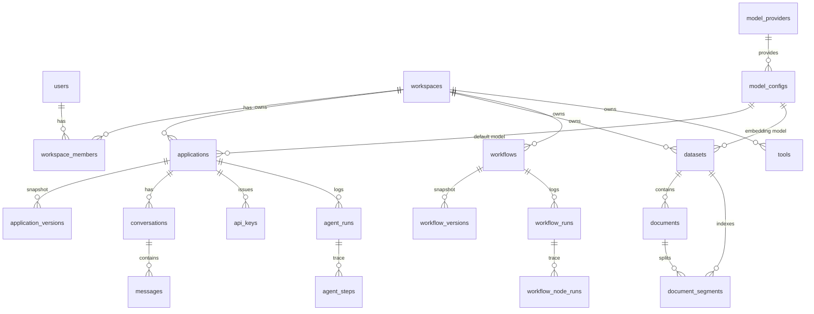

# 数据库设计

PostgreSQL + SQLAlchemy 2.x，ID 采用 32 位 hex UUID（跨库稳定、可读性好）。所有表含 `created_at`（索引）、`updated_at`。

## ER 关系

## 表定义（字段为关键项，非全量）

### 用户与工作空间

| 表 | 主要字段 |
| --- | --- |
| `users` | id, email(uniq,idx), username(uniq,idx), hashed_password, is_active, is_superuser |
| `workspaces` | id, name, description, owner_id → users.id |
| `workspace_members` | id, workspace_id, user_id, role(owner/admin/member)，唯一约束 (workspace_id,user_id) |

### 模型

| 表 | 主要字段 |
| --- | --- |
| `model_providers` | id, name, provider_type(idx), base_url, api_key_encrypted(text), enabled, is_default, remark |
| `model_configs` | id, provider_id → providers, display_name, model_name, model_type(llm/embedding/rerank), temperature, top_p, max_tokens, context_window, supports_streaming, supports_tool_call, is_default, enabled |

### 应用与对话

| 表 | 主要字段 |
| --- | --- |
| `applications` | id, workspace_id(idx), name(idx), description, icon, app_type(idx), status(idx), config(JSON), model_config_id, workflow_id, api_enabled, published_at, run_count |
| `application_versions` | id, application_id(idx), version, config(JSON), note |
| `conversations` | id, application_id(idx), user_id(idx), session_id(idx), title, source(debug/api) |
| `messages` | id, conversation_id(idx), role, content, prompt_tokens, completion_tokens, meta(JSON) |
| `api_keys` | id, application_id(idx), name, key_prefix(idx), key_hash(uniq,idx), enabled, last_used_at |

`applications.config` 结构（由 `AgentConfig` Pydantic 模型校验）：
`system_prompt / user_prompt / welcome_message / opening_questions / mode / model_config_id / temperature / top_p / max_tokens / max_steps / max_tool_calls / max_context_messages / enable_memory / enable_tools / enable_knowledge / tools[] / dataset_ids[] / knowledge_top_k / knowledge_threshold / variables[]`

### 知识库

| 表 | 主要字段 |
| --- | --- |
| `datasets` | id, workspace_id(idx), name(idx), description, embedding_model_id, chunk_size, chunk_overlap, split_strategy, separator, keep_heading, clean_whitespace, index_status, doc_count, segment_count |
| `documents` | id, dataset_id(idx), name, filename, file_path, file_type, file_size, status(idx), progress, error, char_count, chunk_count |
| `document_segments` | id, dataset_id(idx), document_id(idx), position, content(text), tokens, heading, embedding(JSON float[]), extra(JSON) |

索引建议：`document_segments(dataset_id, document_id)` 已有；上量后加 `datasets(workspace_id, index_status)`、`documents(dataset_id, status)`。

### 工具

| 表 | 主要字段 |
| --- | --- |
| `tools` | id, workspace_id(idx, nullable=全局内置), name, tool_key(idx), description, tool_type(builtin/http), parameters(JSON), config(JSON), is_builtin, enabled |

### 工作流

| 表 | 主要字段 |
| --- | --- |
| `workflows` | id, workspace_id(idx), name(idx), description, graph(JSON: nodes/edges), version, status, run_count |
| `workflow_versions` | id, workflow_id(idx), version, graph(JSON), note |
| `workflow_runs` | id, workflow_id(idx), application_id(idx), status(idx), inputs(JSON), outputs(JSON), error, started_at, finished_at, duration_ms, total_tokens, source |
| `workflow_node_runs` | id, run_id(idx), node_id(idx), node_type, title, status, inputs(JSON), outputs(JSON), error, order_index, duration_ms, logs(JSON) |

### 运行日志

| 表 | 主要字段 |
| --- | --- |
| `agent_runs` | id, application_id(idx), conversation_id(idx), status(idx), user_input, output, mode, model_name, prompt/completion/total_tokens, steps_count, tool_calls, error, started_at, finished_at, duration_ms, source, extra(JSON) |
| `agent_steps` | id, run_id(idx), step_index, step_type(thought/action/observation/final/error), content, tool_name, tool_input(JSON), tool_output(JSON), tokens, duration_ms |
| `llm_call_logs` | id, run_id(idx), application_id(idx), provider, model_name, tokens, latency_ms, status(idx), error |

## 迁移

- 初始迁移：`migrations/versions/5489f0aa867c_initial_schema.py`（自动生成，含 PostgreSQL 下 `CREATE EXTENSION IF NOT EXISTS vector`）
- 生成新迁移：`alembic revision --autogenerate -m "xxx"`
- 应用：`alembic upgrade head`
